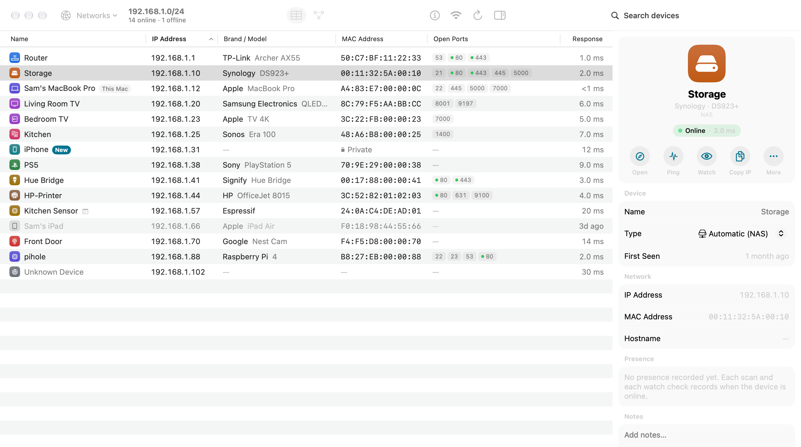
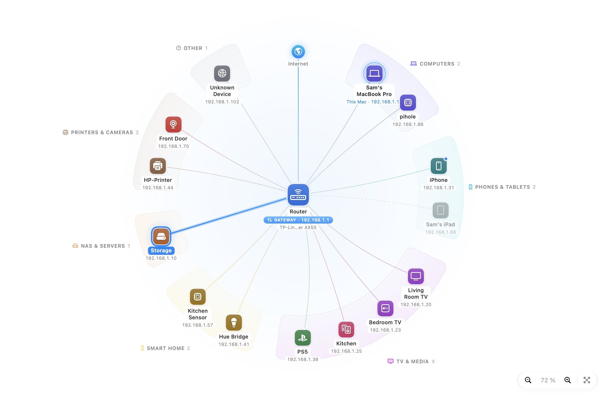
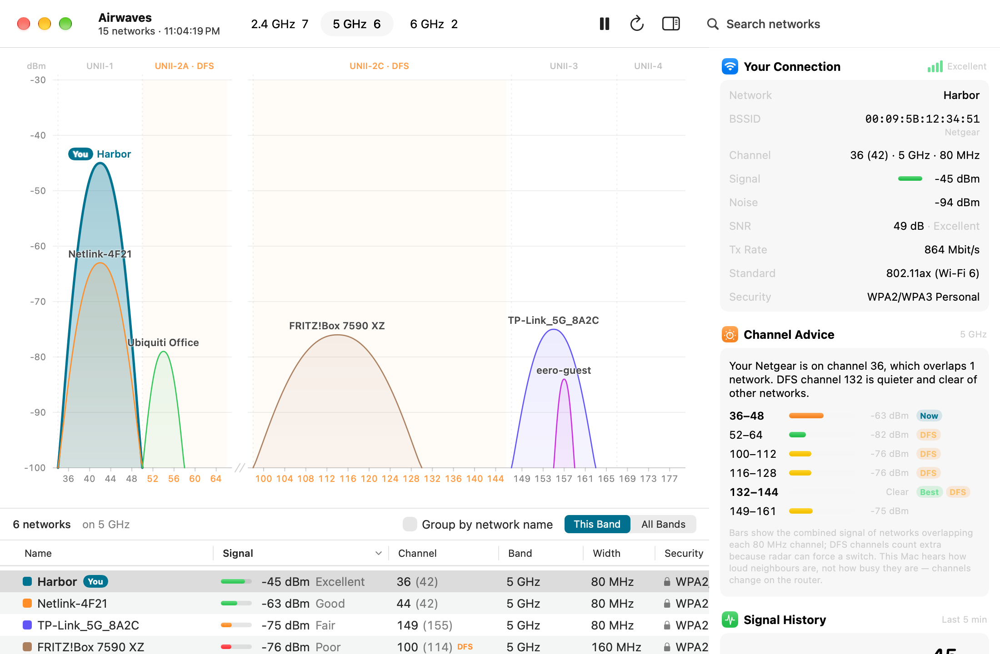
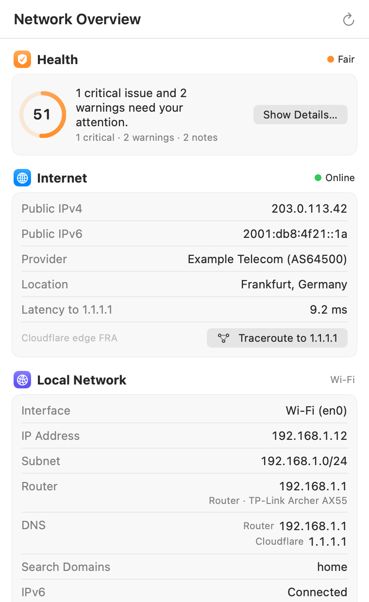
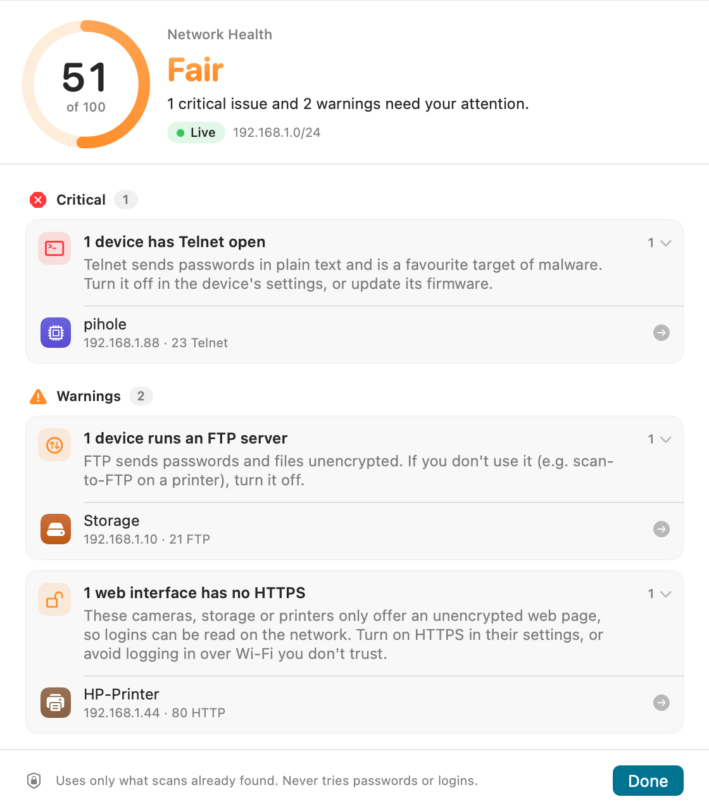
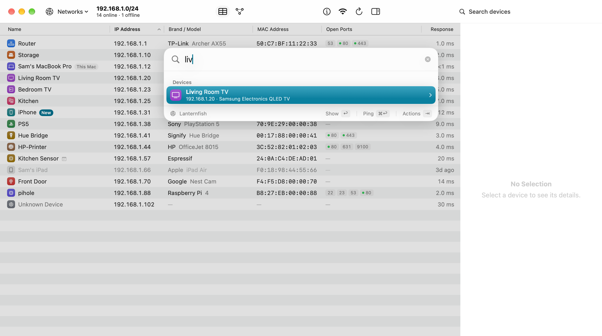
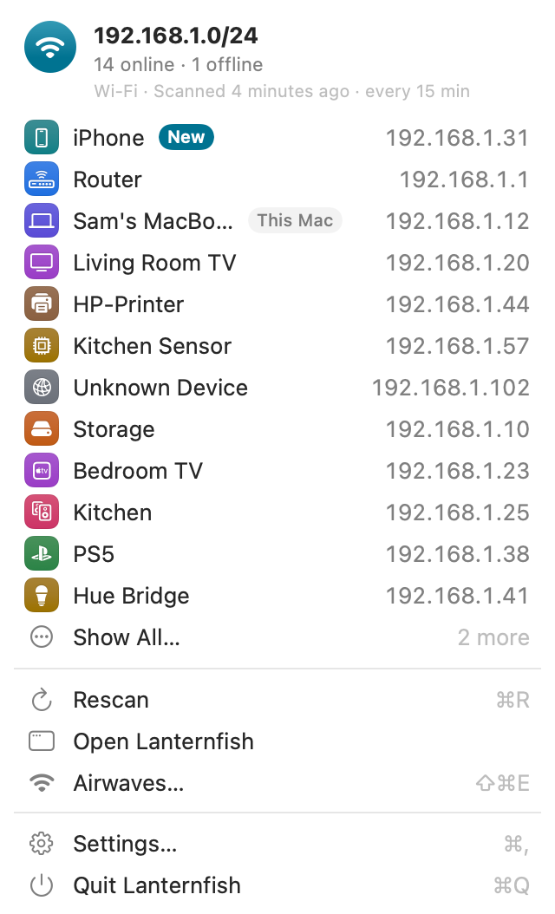

<p align="center">
  
</p>

<h1 align="center">Lanternfish</h1>

<p align="center">
  <b>Light up your network.</b><br>
  A fast, native macOS network scanner that finds, names and maps everything on your LAN,<br>
  and tells you when something new joins or a device you care about goes offline.
</p>

<p align="center">
  <a href="https://github.com/semvis123/lanternfish/releases/latest">Download</a> ·
  <a href="#features">Features</a> ·
  <a href="#install">Install</a> ·
  <a href="#build-from-source">Build from source</a> ·
  <a href="#privacy">Privacy</a>
</p>

<p align="center">
  <picture><source media="(prefers-color-scheme: dark)" srcset="docs/images/devices-dark.png"></picture>
</p>

## Features

**Find everything, fast.** Lanternfish sweeps every network you're connected to at once (Wi-Fi, Ethernet,
USB and Thunderbolt adapters) with ARP, ICMP and TCP probes. Devices appear within a second and a
full scan takes a few seconds.

**Real names, not just IP addresses.** Lanternfish combines Bonjour, SSDP/UPnP, NetBIOS, reverse DNS,
your router's DNS, the IEEE vendor registry, HTTP banners and open ports to work out what each device
is, such as "Living Room TV · Samsung QLED" or "HP OfficeJet 8015", with a product icon to match.

| | |
|---|---|
| <picture><source media="(prefers-color-scheme: dark)" srcset="docs/images/map-dark.jpg"></picture> | <picture><source media="(prefers-color-scheme: dark)" srcset="docs/images/airwaves-dark.png"></picture> |
| **Network map.** A live, zoomable map of how your devices connect, grouped around the router. | **Airwaves.** Nearby Wi-Fi networks on a channel graph for 2.4, 5 and 6 GHz, with plain-language channel advice. |
| <picture><source media="(prefers-color-scheme: dark)" srcset="docs/images/overview-dark.png"></picture> | <picture><source media="(prefers-color-scheme: dark)" srcset="docs/images/health-dark.png"></picture> |
| **Overview.** Your public IP and provider, Wi-Fi link details, DNS servers, and a built-in speed test. | **Network health.** Flags risky open services (Telnet, FTP, exposed file sharing, router admin over HTTP, weak Wi-Fi security) and explains each one. |
| <picture><source media="(prefers-color-scheme: dark)" srcset="docs/images/palette-dark.png"></picture> | <picture><source media="(prefers-color-scheme: dark)" srcset="docs/images/menubar-dark.png"></picture> |
| **Quick Search (⌘K).** Jump to any device, run any action, or type an IP or hostname to ping or trace it. | **Menu bar.** Devices online across all your networks, watched devices, and one-click rescans, even with the window closed. |

**And more:**

- **Alerts** when a new device joins, or a watched device goes offline and comes back.
- **History** of every device seen on each network, with first and last seen times and a presence timeline.
- **Device tools:** ping, traceroute, a full 65,535-port scan, service details (banners, TLS certificates,
  HTTP headers), Wake-on-LAN, rename and notes.
- **Multiple networks** side by side, plus saved networks you can browse while you're away.
- **Automatic rescans**, launch at login, and light and dark mode.

## Install

Lanternfish needs **macOS 27 or later** on a Mac with Apple silicon.

1. Download `Lanternfish.dmg` from the [latest release](https://github.com/semvis123/lanternfish/releases/latest).
2. Open it and drag **Lanternfish** into **Applications**.
3. Open Lanternfish. Release builds aren't notarized yet, so macOS blocks the first launch:
   1. Click **Done** in the warning.
   2. Open **System Settings › Privacy & Security**, scroll down and click **Open Anyway** next to
      "Lanternfish was blocked".
   3. Confirm with **Open Anyway** and your password.

   You only need to do this once per version.

### Permissions

On first launch a welcome window asks for the permissions Lanternfish uses. You can reopen it from
**Help › Show Welcome…**.

| Permission | Why |
|---|---|
| **Local Network** | To find devices. macOS doesn't let apps check this one; if nothing shows up, turn Lanternfish on in **System Settings › Privacy & Security › Local Network**. |
| **Notifications** | For new-device and watched-device alerts. Optional. |
| **Location** | Only because macOS hides Wi-Fi network names (SSIDs) from apps without it. Lanternfish never reads or stores your location. Optional. |

## Build from source

You need macOS 27 and Xcode 27 (Swift 6.4), or the matching Command Line Tools.

```sh
git clone https://github.com/semvis123/lanternfish.git
cd lanternfish
./scripts/install.sh      # build, install to /Applications/Lanternfish.app and open it
```

Other useful commands:

```sh
./scripts/build-app.sh    # build build/Lanternfish.app without installing
swift test                # run the LanternfishKit test suite
swift format lint --strict --recursive Sources Tests
```

`./scripts/install.sh --dry-run` prints the steps without changing anything.

Local builds are signed ad-hoc, and macOS may forget the Local Network and Location permissions
after a rebuild. To keep them, sign with your own certificate:

```sh
security find-identity -p codesigning -v      # list your signing identities
CODESIGN_IDENTITY="Apple Development: Your Name (TEAMID)" ./scripts/install.sh
```

### Project layout

| Path | What's there |
|---|---|
| `Sources/LanternfishKit` | The scanning engine: discovery, naming and fingerprinting, history, Wi-Fi, health checks. No UI; covered by `swift test`. |
| `Sources/Lanternfish` | The SwiftUI app: windows, map, menu bar, notifications. |
| `Tests/LanternfishKitTests` | Unit tests. A few opt-in tests touch your real network; see the `LANTERNFISHKIT_*` variables in the test files. |
| `scripts/` | Build, install, icon and vendor-database scripts, plus `screenshots.sh` for the images in this README. |

### Screenshots and debug hooks

The images in this README come from a built-in demo network, not a real one. Debug builds (or
`DEBUG_HOOKS=1 ./scripts/build-app.sh`) read `LANTERNFISH_*` environment variables that load fake data and
render windows to PNG files. `./scripts/screenshots.sh` regenerates every image. Normal release builds
compile these hooks out.

## Privacy

Lanternfish has no accounts, analytics or telemetry. Everything it learns about your network stays on your
Mac, in `~/Library/Application Support/Lanternfish`.

It only contacts the internet when you open the Overview: it asks Cloudflare for your public IP address
and provider, and the speed test downloads and uploads test data from Cloudflare.

## Contributing

Bug reports and pull requests are welcome. See [CONTRIBUTING.md](CONTRIBUTING.md). Report security issues
privately as described in [SECURITY.md](SECURITY.md).

## License

Lanternfish's source code is available under the [PolyForm Shield License 1.0.0](LICENSE.md). You can use,
change and share it for any purpose, including at work, **except** to offer a product that competes
with Lanternfish.

The Lanternfish name and icon are not covered by that license; see [assets/README.md](assets/README.md).

Device vendor names come from the [IEEE MA-L registry](https://standards-oui.ieee.org/).
